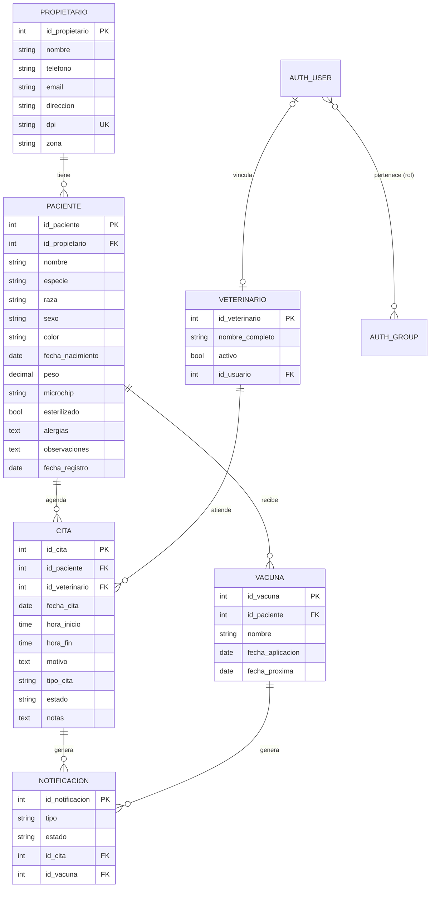

# Sistema Web de Gestión para una Veterinaria

Trabajo de graduación: *Desarrollo de un Sistema Web de Gestión para una Veterinaria*
(Universidad Mariano Gálvez de Guatemala). El sistema se construyó con **Python + Django 5.2 LTS + MySQL 8** y usa **Bootstrap 5** en el frontend. El desarrollo siguió la metodología **RUP**.

El sistema cubre los **5 módulos** del alcance (Capítulo I) y los **21 requerimientos funcionales** (Tabla 4.4):

| Módulo (app Django) | Qué hace | Requerimientos |
|---|---|---|
| `usuarios` | Inicio y cierre de sesión, usuarios, roles (Administrador, Veterinario, Recepcionista) y permisos por rol | RF-01 a RF-04 |
| `pacientes` | Propietarios (con DPI y zona), pacientes (con alergias resaltadas), carnet del paciente, búsqueda, vacunas e importación CSV | RF-05 a RF-08 |
| `citas` | Panel principal, agenda, calendario mensual, alta/modificación/cancelación de citas, estados y **validación de disponibilidad** | RF-09 a RF-13, RF-18 |
| `notificaciones` | Correos SMTP de confirmación, modificación y cancelación, recordatorios automáticos, configuración SMTP e historial de envíos | RF-14 a RF-17 |
| `reportes` | Reportes por estado, tipo, veterinario, especie y sexo; tendencia mensual; filtro por período; exportación a Excel (CSV) | RF-19 a RF-21 |

---

## 1. Estructura del proyecto

```
sistema-veterinaria/
├── manage.py
├── requirements.txt          ← dependencias
├── .env.example              ← plantilla de configuración (copiar como .env)
├── clinica/                  ← proyecto Django (settings, urls, plantillas base, CSS/JS)
│   ├── settings.py
│   ├── urls.py
│   ├── context_processors.py
│   ├── templates/            ← base.html, menú, 403/404/500
│   └── static/               ← css/estilos.css, js/citas.js
├── usuarios/                 ← módulo 1: autenticación, usuarios y roles
├── pacientes/                ← módulo 2: propietarios, pacientes y vacunas
├── citas/                    ← módulo 3: citas, veterinarios, dashboard y calendario
├── notificaciones/           ← módulo 4: correos SMTP y recordatorios
├── reportes/                 ← módulo 5: reportes y estadísticas
├── database/
│   ├── 01_crear_base_datos.sql          ← crea la BD y el usuario de MySQL
│   ├── 02_clinica_veterinaria_completa.sql ← BD COMPLETA: tablas + datos + vistas + triggers
│   ├── 03_objetos_adicionales.sql       ← solo vistas, procedimientos y triggers
│   └── plantillas_importacion/          ← CSV de ejemplo para migrar datos históricos
└── scripts/                  ← .bat para Windows: servidor, recordatorios, respaldos
```

### Cambios respecto al repositorio anterior

Se reorganizó el proyecto anterior por estas razones:

1. **Había dos proyectos Django mezclados.** `config/` (Django 6.1) no tenía las apps registradas, y `manage.py` apuntaba a él, por lo que ningún módulo funcionaba. El sistema quedó en un solo proyecto: `clinica/`.
2. **Había credenciales en el código.** La clave de Gmail y la SECRET_KEY estaban escritas en `settings.py`. Ahora se leen desde `.env`, como indica la sección 6.1.4 del documento.
3. **Los módulos se renombraron según la Tabla 5.6.** `autenticacion` pasó a llamarse `usuarios` y `recordatorios` pasó a llamarse `notificaciones`.
4. **Los modelos siguen el diccionario de datos (Tablas 5.1 a 5.5).** Antes, la cita guardaba el nombre de la mascota y del dueño como texto. Ahora se relaciona con `paciente` y `veterinario` (3FN).
5. **Se completaron las partes que faltaban.** Faltaban plantillas, URLs de reportes y recordatorios, migraciones y las vistas de recordatorios.

> ⚠️ **Importante:** la contraseña de Gmail `ariasreyesdaniela8@gmail.com` quedó publicada en el historial de GitHub. **Cámbiela** y use una *contraseña de aplicación* nueva en el archivo `.env`.

---

## 2. Requisitos (Tabla 6.1)

| Componente | Versión |
|---|---|
| Python | 3.10 a 3.13 |
| Django | 5.2 LTS (soporte hasta abril de 2028) |
| MySQL Community Server + Workbench | 8.4 LTS (u 8.0.16 o superior) |
| PyMySQL | 1.1 |
| django-crispy-forms + crispy-bootstrap5 | 2.x / 2024.10+ |
| whitenoise + waitress | para servir el sistema en la red local |
| Navegador | Chrome, Edge o Firefox actualizados |

---

## 3. Instalación paso a paso (Windows)

### 3.1 Descargar el proyecto y crear el entorno virtual

```bat
git clone https://github.com/Dany200318/sistema-veterinaria.git
cd sistema-veterinaria
python -m venv venv
venv\Scripts\activate
pip install -r requirements.txt
```

### 3.2 Crear el archivo `.env`

```bat
copy .env.example .env
```

Abra `.env` y complete los valores:

- **SECRET_KEY:** genere una clave nueva con
  `python -c "from django.core.management.utils import get_random_secret_key as g; print(g())"`
- **DB_PASSWORD:** debe ser la misma contraseña del script `01_crear_base_datos.sql`.
- **EMAIL_USER y EMAIL_PASSWORD:** el correo de la clínica y su contraseña de aplicación (ver sección 4).

> 💡 Para probar sin MySQL, use `DB_ENGINE=sqlite`. El sistema creará un archivo `db.sqlite3` local, que es el entorno de desarrollo de la Tabla 3.6.

### 3.3 Crear la base de datos MySQL

Abra **MySQL Workbench** con el usuario `root`. Vaya a *File → Open SQL Script* y ejecute **`database/01_crear_base_datos.sql`** con el botón ⚡. Este script crea la base `clinica_veterinaria` en utf8mb4 y el usuario `clinica_app`.

Después elija **uno** de estos dos caminos:

#### Camino A: con migraciones de Django (recomendado, sección 6.1.5)

```bat
python manage.py migrate
python manage.py createsuperuser
python manage.py cargar_datos_demo --usuarios
```

- `migrate` crea todas las tablas y los 3 roles.
- `createsuperuser` crea su usuario administrador.
- `cargar_datos_demo` es opcional: carga datos de prueba y los usuarios `veterinaria` y `recepcion`.

Si además quiere las vistas, los procedimientos almacenados y los triggers de MySQL, ejecute **`database/03_objetos_adicionales.sql`** en Workbench con el usuario root.

#### Camino B: importar la base de datos completa

Ejecute **`database/02_clinica_veterinaria_completa.sql`** en Workbench. Ese script crea todas las tablas, los roles, los usuarios, los datos de prueba, las vistas, los procedimientos y los triggers. Luego ejecute:

```bat
python manage.py migrate
```

Responderá *"No migrations to apply"* y registrará los permisos internos de Django.

Usuarios que crea el script (**cambie las contraseñas al ingresar**):

| Usuario | Contraseña | Rol |
|---|---|---|
| `admin` | `Admin2026!` | Administrador (superusuario) |
| `veterinaria` | `Clinica2026!` | Veterinario |
| `recepcion` | `Clinica2026!` | Recepcionista |

### 3.4 Iniciar el sistema

```bat
python manage.py runserver
```

Abra **http://127.0.0.1:8000** e inicie sesión.

---

## 4. Correo electrónico (RF-14 a RF-17, sección 6.1.6)

1. En la cuenta de Gmail de la clínica, active la **verificación en dos pasos**.
2. Vaya a *Cuenta de Google → Seguridad → Contraseñas de aplicaciones* y genere una contraseña de 16 caracteres.
3. Póngala en `.env` como `EMAIL_PASSWORD`, y el correo como `EMAIL_USER`.
4. En el sistema, vaya a **Administración → Correo (SMTP)** y pulse **Enviar correo de prueba**.

También puede configurar el servidor SMTP desde esa pantalla (HU-16). Para eso, marque *"usar esta configuración"*.

Para probar sin enviar correos reales, use `EMAIL_MODO=console` en `.env`. Los mensajes se mostrarán en la terminal.

**Comportamiento al agendar o modificar una cita (CU-05):**

- La cita **siempre se guarda**.
- Si el correo se envía, aparece un mensaje verde.
- Si el correo falla, aparece una advertencia amarilla (RF-15) y el error queda en **Administración → Notificaciones**. Desde ahí se puede reintentar el envío.

### Recordatorios automáticos (RF-16)

```bat
python manage.py enviar_recordatorios
```

Este comando envía dos tipos de recordatorio:

- Para las citas pendientes o confirmadas de **mañana**.
- Para las vacunas cuya próxima dosis vence en los **próximos 7 días**.

Los dos plazos se pueden cambiar en la pantalla de configuración. El comando no repite recordatorios que ya se enviaron.

**Programación diaria en Windows:**

1. Abra el *Programador de tareas* y elija *Crear tarea básica*.
2. Póngale el nombre "Recordatorios clínica".
3. En *Desencadenador*, elija *Diariamente* a las 07:00.
4. En *Acción*, elija *Iniciar un programa* y seleccione `scripts\enviar_recordatorios.bat`.

El resultado de cada ejecución se guarda en `logs\recordatorios.log`.

---

## 5. Puesta en producción en la red local (secciones 6.1.7 y 6.1.9)

1. En `.env` cambie estos valores:
   - `DEBUG=False`
   - `ALLOWED_HOSTS=localhost,127.0.0.1,192.168.1.50`, usando la IP del servidor
   - `SECRET_KEY`: una clave nueva
2. Inicie el sistema con **`scripts\iniciar_servidor.bat`**. Este script usa *waitress*, un servidor de producción compatible con Windows.
3. Configure el **Firewall de Windows**:
   - Permita el puerto **8000** solo desde la red local.
   - **No** abra el puerto 3306 de MySQL.
4. Los demás equipos de la clínica ingresan con `http://192.168.1.50:8000`.

### Respaldos (RNF-07)

- **`scripts\respaldo_bd.bat`** genera `respaldos\clinica_AAAA-MM-DD_HHMM.sql`. El respaldo incluye las rutinas y los triggers, y el script borra los respaldos de más de 30 días. Prográmelo a diario y copie la carpeta a un disco externo o a la nube.
- **`scripts\restaurar_bd.bat respaldos\archivo.sql`** restaura un respaldo. Pruebe la restauración al menos una vez, como pide la verificación de RNF-07.

> Si su MySQL no está instalado en `C:\Program Files\MySQL\MySQL Server 8.4\bin`, edite la variable `MYSQL_BIN` en los dos `.bat`.

### Migración de datos históricos (sección 6.1.8)

1. Copie los datos de la agenda y de las hojas de cálculo en las plantillas de `database/plantillas_importacion/`.
2. En Excel, guárdelas como *CSV UTF-8*.
3. Ejecute primero la validación y después la importación:

```bat
python manage.py importar_datos_csv --propietarios propietarios.csv --pacientes pacientes.csv --probar
python manage.py importar_datos_csv --propietarios propietarios.csv --pacientes pacientes.csv
```

- Con `--probar`, el comando valida los datos sin guardar nada.
- Sin esa opción, los importa.
- Si alguna fila tiene errores, no se guarda ningún registro y el comando indica la fila y el motivo.

---

## 6. Roles y permisos (Tabla 5.7)

| Funcionalidad | Administrador | Veterinario | Recepcionista |
|---|---|---|---|
| Gestionar usuarios y roles | Sí | No | No |
| Registrar y editar propietarios y pacientes | Sí | Sí | Sí, **sin eliminar** |
| Agendar, modificar y cancelar citas | Sí | Sí | Sí |
| Consultar el panel principal | Sí | Sí | Sí |
| Consultar reportes y estadísticas | Sí | Sí | No |

Los roles se guardan como grupos de Django (`auth_group`). Si un usuario intenta usar una función que su rol no permite, el sistema muestra la página **403 – Acceso denegado** (CP-03). Además, todas las páginas exigen sesión iniciada (CP-15).

---

## 7. Regla de disponibilidad horaria (RF-10, CU-05)

Al guardar una cita, el sistema verifica que **el veterinario no tenga otra cita activa que se traslape** en ese día. Por ejemplo, de 09:00 a 09:30 y de 09:15 a 09:45 se traslapan. También verifica que el **mismo paciente** no tenga dos citas simultáneas.

- Las citas **canceladas liberan el horario**.
- Si la cita no tiene hora de fin, se asume una duración de 30 minutos. Se configura con `CITA_DURACION_MINUTOS`.
- Mientras se llena el formulario, el sistema consulta en segundo plano los horarios ocupados y avisa si hay choque (HU-07).
- La verificación se repite dentro de una transacción con bloqueo (`SELECT … FOR UPDATE`). Así, dos recepcionistas no pueden reservar el mismo horario al mismo tiempo.
- Si se ejecutó el script SQL 02 o 03, un **trigger de MySQL** aplica la misma regla en la propia base de datos.

---

## 8. Pruebas (Tablas 6.2 y 6.3)

```bat
python manage.py test
```

Las pruebas automáticas corresponden a los casos de prueba del Capítulo VI:

| Caso | Prueba automática |
|---|---|
| CP-01, CP-02 | `usuarios.tests.AutenticacionTests` (inicio de sesión válido e inválido) |
| CP-03, CP-15 | Acceso denegado por rol y redirección al inicio de sesión |
| CP-04 a CP-06 | `pacientes.tests` (propietario, paciente y búsqueda) |
| CP-07 a CP-10 | `citas.tests.ValidacionDisponibilidadTests` y `VistasCitasTests` |
| CP-11, CP-12 | Correo enviado, y cita guardada con advertencia cuando el SMTP falla |
| CP-13 | Totales del panel principal |

> Con MySQL, el usuario `clinica_app` necesita permiso para crear la base `test_clinica_veterinaria`. El script 01 ya lo otorga.

---

## 9. Modelo de datos



La base de datos también incluye estos objetos de MySQL (scripts 02 y 03):

| Tipo | Nombre | Para qué sirve |
|---|---|---|
| Vista | `v_citas_detalle` | Detalle completo de cada cita |
| Vista | `v_agenda_hoy` | Citas del día |
| Vista | `v_resumen_mensual_citas` | Tendencia mensual (RF-20) |
| Vista | `v_vacunas_por_vencer` | Vacunas vencidas o próximas a vencer |
| Vista | `v_indicadores_panel` | Indicadores del panel principal (RF-18) |
| Vista | `v_efectividad_notificaciones` | Porcentaje de correos entregados (meta 95 %) |
| Procedimiento | `sp_verificar_disponibilidad` | Busca citas que choquen con un horario |
| Procedimiento | `sp_reporte_citas_periodo` | Reporte de citas por período |
| Procedimiento | `sp_agenda_veterinario` | Agenda de un veterinario |
| Trigger | `trg_cita_validar_insert`, `trg_cita_validar_update` | Impide citas traslapadas en la base de datos |

---

## 10. Ajustes sugeridos al documento de tesis

Estos son los puntos donde el sistema y el documento difieren. Conviene actualizar el documento para que coincida con el código:

| Sección | Situación actual | Sugerencia |
|---|---|---|
| Tabla 6.1 | Django 5.1 | Django 5.1 ya no recibe soporte. El sistema usa **Django 5.2 LTS**. |
| Tabla 6.1 | crispy-bootstrap4 | Las pantallas usan Bootstrap 5, por lo que el sistema usa **crispy-bootstrap5**. |
| Tabla 6.1 | MySQL 8.0.x | MySQL 8.0 ya terminó su soporte. Se recomienda **MySQL 8.4 LTS**; el sistema funciona con ambas. |
| Figura 5.1 y Tablas 5.1–5.5 | El modelo no incluye vacunas ni notificaciones | Agregar **VACUNA** (Tabla 6.5 «Control de vacunas» y objetivo específico 4) y **NOTIFICACION** (fuente del indicador «notificaciones entregadas»). Ver el diagrama de la sección 9. |
| Tabla 5.4 | Veterinario solo tiene nombre y estado | Se agregó `id_usuario` (opcional) para vincular al veterinario con su usuario y filtrar «mis citas» (HU-09). |
| Tabla 5.5 | — | Se agregaron `fecha_creacion`, `fecha_actualizacion` e `id_usuario_registro` (auditoría). |
| Sección 5.4.2 | `select_related("id_paciente", "id_veterinario")` | En el código, el campo se llama `paciente` y su columna es `id_paciente`. Use `select_related("paciente", "veterinario")`. |
| Sección 6.1.5 | Solo menciona `makemigrations`/`migrate` | Agregar `python manage.py cargar_datos_demo` (datos de prueba) y los scripts SQL. |

---

## 11. Solución de problemas

| Problema | Solución |
|---|---|
| `mysqlclient 2.2.1 or newer is required` | Ya está resuelto en `clinica/__init__.py`. Verifique que PyMySQL esté instalado. |
| `Access denied for user 'clinica_app'` | La contraseña de `.env` no coincide con la del script 01. |
| `Table 'xxx' already exists` al ejecutar `migrate` | Ya importó el script 02. Ejecute `python manage.py migrate --fake-initial`. |
| `You do not have the SUPER privilege…` al crear triggers | Ejecute el script 02 o 03 como **root**. |
| `SMTPAuthenticationError` | Use una *contraseña de aplicación* de Gmail, no la contraseña normal de la cuenta. |
| La página se ve sin estilos con `DEBUG=False` | Ejecute `python manage.py collectstatic`. `iniciar_servidor.bat` ya lo hace. |
| Se olvidó la contraseña del administrador | Ejecute `python manage.py changepassword admin`. |
